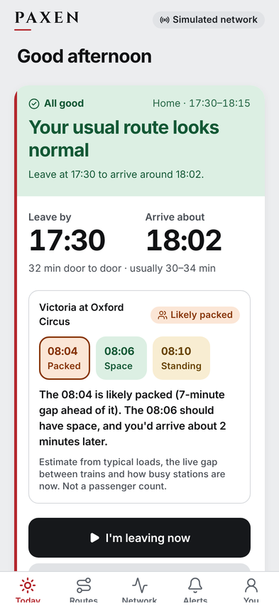
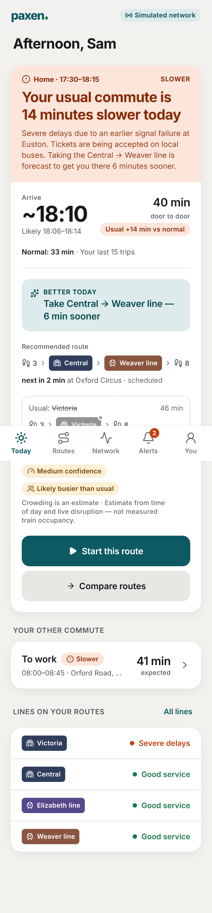
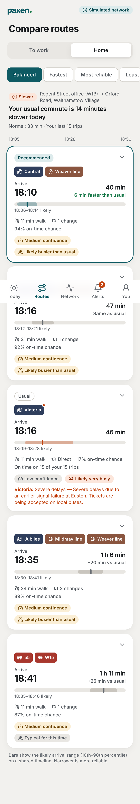

# Paxen

**Know before you go.** A personalised commute assistant for London: it learns your Home → Work routine,
watches buses, the Underground, Overground, Elizabeth line and National Rail, notices when *your* normal
commute isn't normal today, and recommends a better route before you leave, with an honest confidence level.

```
backend/   Python (FastAPI) — data recorder, prediction engine, alert rules, REST API
web/       Next.js mobile-first PWA (UI generated with v0, wired to the API)
docs/      API contract, product decisions, data sources
```

## Run it locally

Backend (uses a built-in **simulated London network** by default, so it works with no API keys):

```bash
cd backend
python3 -m venv .venv && . .venv/bin/activate
pip install -r requirements-dev.txt
uvicorn paxen.main:app --reload --port 8000
```

Real TfL data instead of the simulator:

```bash
PAXEN_PROVIDER=tfl TFL_APP_KEY=your-key uvicorn paxen.main:app --port 8000
```

Web app:

```bash
cd web
pnpm install
NEXT_PUBLIC_PAXEN_API_URL=http://localhost:8000 pnpm dev
```

Without `NEXT_PUBLIC_PAXEN_API_URL` the web app runs in demo mode on bundled sample data.
The UI was generated in v0 ([chat](https://v0.app/chat/k0gLb8FzfOs)); design tokens live in `web/lib/paxen-tokens.ts`.

| Normal day | Disrupted | Compare routes |
|---|---|---|
|  |  |  |

Tests:

```bash
cd backend && pytest -q
```

### Demo script (simulator)
1. Open the app, onboard (search "Orford" for Home, "Regent" for Work).
2. **You → Simulator → Backfill history.** This replays two hours of feed polling, trains and promotes the
   correction model, and adds three weeks of past trips, so you get a personal baseline.
3. Pick the scenario **victoria-severe** and tap **Check for alerts now**. Today shows the slowdown and the
   better route, and Alerts gets a notification you can rate.

## Configuration

| Variable | Default | Meaning |
|---|---|---|
| `PAXEN_PROVIDER` | `sim` | `sim` or `tfl` |
| `TFL_APP_KEY` | – | TfL Unified API key |
| `PAXEN_DATABASE_URL` / `DATABASE_URL` | `sqlite:///./paxen.db` | database; `postgres://…` URLs from Railway/Render work as-is |
| `PAXEN_RUN_WORKERS` | `1` | run recorder / monitor / training inside the API process (set `0` in production and run `python -m paxen.worker`) |
| `PAXEN_POLL_INTERVAL` | `30` | seconds between feed polls |
| `PAXEN_SIM_SCENARIO` | `auto` | `auto`, `normal`, `victoria-severe`, `victoria-suspended`, `central-minor`, `weaver-suspended`, `mixed` |
| `PAXEN_CORS_ORIGINS` | `*` | comma-separated allowed origins |

Deploying (Railway + Vercel, step by step): [docs/deploy.md](docs/deploy.md).

See [docs/product.md](docs/product.md) for how the brief maps to the code, and what was added or cut.
